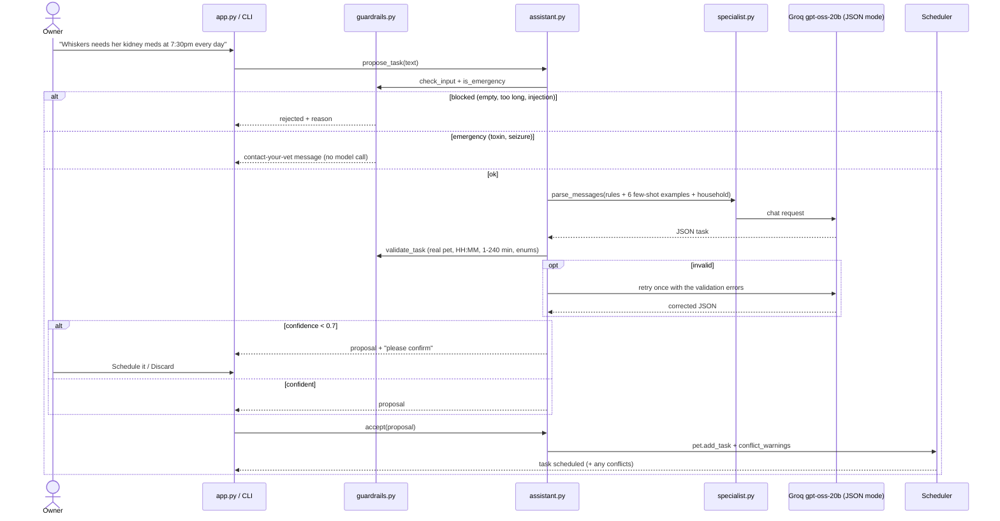
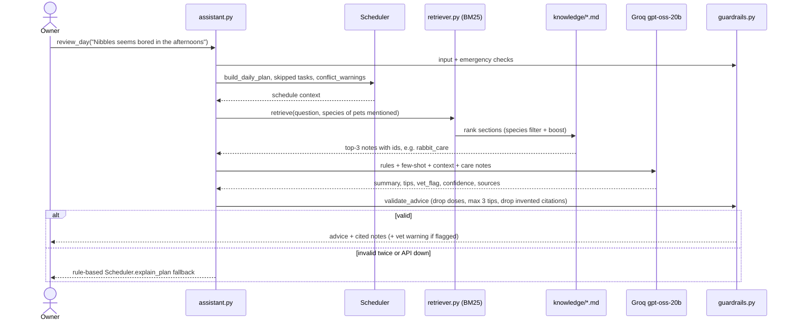
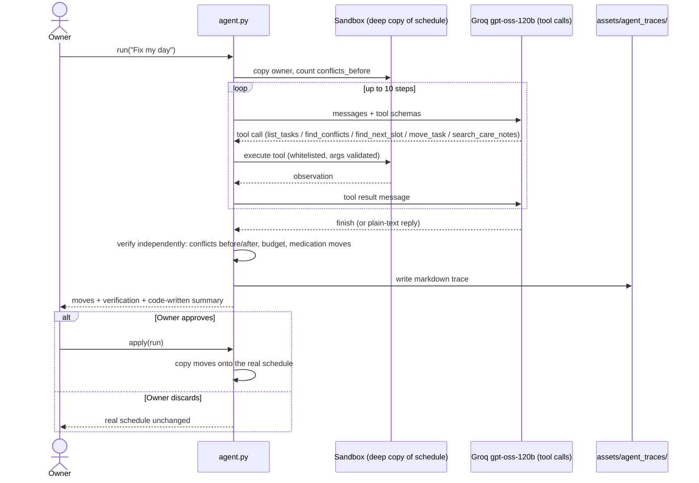
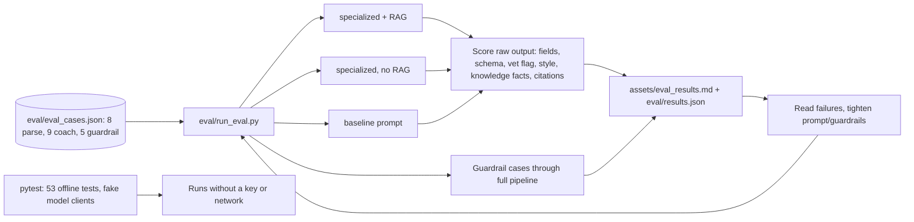

# PawPal AI workflows

The overall system is in [architecture.mmd](architecture.mmd). These sequence diagrams show each workflow step by step, matching the code in `pawpal_ai/`.

## 1. Plain-English task entry (specialized model + human-in-the-loop)

## 2. Care Coach review (RAG over the knowledge base)

## 3. Fix-my-day agent (plan, act, verify, approve)

## 4. Reliability and evaluation loop

